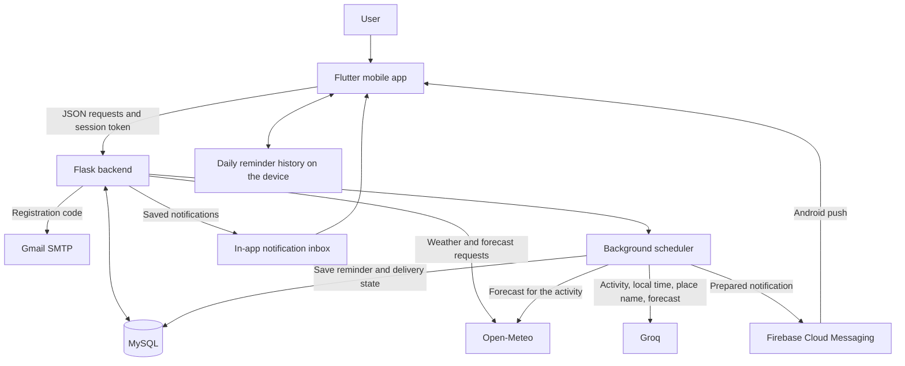

# HeatGuard: presentation and defense notes

Prepared from the current project on October 22, 2026. These notes describe the Flutter mobile application and distinguish working features from proposed improvements. Configuration values mentioned below are code defaults and can be overridden by the server environment.

## 1. Opening explanation

> HeatGuard is a mobile heat-awareness application that combines local weather information, calculated heat-risk levels, and personalized reminders. Users verify their email, save their own addresses, and create routines. Before a scheduled activity, the backend checks the forecast for that location and time, asks Groq to write relevant advice, and sends the reminder through Firebase Cloud Messaging. The app also keeps a notification inbox and displays weather history and safety guidance.

**Tagline:** A little awareness. A safer day.

**Problem addressed:** Weather readings alone can be difficult to interpret, and generic reminders may not fit what a person is doing. HeatGuard translates temperature and humidity into understandable risk categories and connects weather advice with a person's planned activity.

**Intended users:** Students, commuters, outdoor workers, families, and people planning daily activities. Its intended contribution is heat awareness and climate adaptation, relevant to SDG 13 and public health. A reduction in heat illness has not been established by a user study.

## 2. Technology stack

| Component | Technology | Responsibility |
| --- | --- | --- |
| Main mobile frontend | Flutter, written in Dart | Screens, forms, navigation, charts, weather illustrations, routines, and inbox |
| Backend | Python with Flask | Account verification, access control, JSON APIs, weather processing, AI requests, and notification scheduling |
| Database | MySQL 8, accessed through PyMySQL | Persistent accounts, locations, weather history, routines, notifications, and delivery records |
| Background processing | Python scheduler threads and worker pools | Periodic weather collection, reminder preparation, and push delivery |
| AI integration | Groq chat-completions API | Writes advice tailored to the routine and forecast |
| Remote notifications | Firebase Cloud Messaging, or FCM | Delivers Android notifications from the backend |
| Verification email | Gmail SMTP using Python's email/SMTP libraries | Sends registration verification codes |
| Configuration | Environment variables and python-dotenv | Loads database settings and server credentials |
| Production server entry point | Waitress | Serves the Flask application through WSGI |

Flutter packages include `http`, `firebase_core`, `firebase_messaging`, `flutter_local_notifications`, `flutter_secure_storage`, `shared_preferences`, `timezone`, and `flutter_timezone`.

The repository also contains an earlier Flask/Jinja web dashboard using HTML, CSS, JavaScript, Bootstrap, and Chart.js, plus a separate web/PWA implementation. **The main mobile app uses Flutter widgets and custom-painted Dart charts.** Android is the demonstrated native platform. Flutter web supports browser preview; iOS files exist, but native iOS builds and remote push have not been validated here.

## 3. External APIs and services

| Integration | What HeatGuard uses it for | Important distinction |
| --- | --- | --- |
| Open-Meteo Forecast API | Current temperature, relative humidity, precipitation, weather code, day/night flag; hourly forecasts for routine times | Supplies weather inputs; HeatGuard calculates its own heat index |
| Open-Meteo Geocoding API | Searches place names and returns coordinates and time zones | Converts a place selection into a weather-query location |
| Open-Meteo Historical Weather API | Optional command-line backfill of historical weather | Historical/model data, not readings from a HeatGuard-owned sensor |
| Groq API | Generates the main activity-specific reminder text | Text generation; it does not determine the weather or risk thresholds |
| Firebase Cloud Messaging HTTP v1 | Sends a prepared notification to a registered Android device | Push transport; it does not generate the advice or schedule the routine |
| Google OAuth through `google-auth` | Authenticates the backend's requests to FCM using a service account | Server credentials stay outside the mobile app |
| Gmail SMTP | Emails a six-digit verification code | SMTP is an email protocol, rather than one of the app's JSON APIs |
| PAGASA/PANaHON public station pages | Optional command-line comparison of the calculation with published station heat indices | Validation reference, not the normal dashboard weather feed |

Open-Meteo exposes the weather variables used here through its [Forecast API documentation](https://open-meteo.com/en/docs). Its data combines weather-model output, so present the displayed values as weather estimates rather than measurements at a user's exact home.

Philippine region, province, city/municipality, and barangay selectors use the **PSA Philippine Standard Geographic Code hierarchy bundled in the `psgc` Python package**. These dropdowns use a local dataset rather than making a third-party address-API request every time. The coordinates represent the selected area; the app does not continuously track the phone using GPS.

The configured default Groq model in code is `openai/gpt-oss-20b`; `GROQ_MODEL` can override it. Requests go to Groq, and no model was trained from scratch for this project. The model is documented by [Groq](https://console.groq.com/docs/model/openai/gpt-oss-20b).

Firebase currently provides messaging for this application. Account authentication and persistent application data are handled by Flask and MySQL; Firebase Authentication, Firestore, and Cloud Functions are not part of this implementation.

## 4. Architecture and data flow



The phone communicates with Flask rather than connecting directly to MySQL. The backend holds the external-service credentials, performs authorization, and owns the scheduling logic.

## 5. Main features and user journey

1. **Register and verify email.** Enter a name, email, and password; receive an OTP; verify it to complete account creation.
2. **Sign in.** Restore a valid session or log in before opening the mobile dashboard.
3. **Save a private address.** Search for a location or select a Philippine address. Each user's addresses are scoped to that account.
4. **Check Today.** See temperature, humidity, calculated heat index, risk label, data freshness, heat alerts, and recommendations.
5. **Inspect Trends.** Explore stored readings over 24 hours or seven days. Charts support inspecting individual readings.
6. **Read Safety guidance.** Review the risk categories and recommendations.
7. **Create a routine.** Choose an activity, saved location, local time, repeat weekdays, and reminder lead time.
8. **Enable phone notifications.** Grant permission and register the device with the backend.
9. **Receive and review reminders.** Read the Android notification and open the persistent notification inbox, with unread counts and read controls.

The interface uses a soft teal, off-white, and warm neutral palette, clear risk labels, bottom navigation, touch-friendly controls, and the custom HeatGuard branding. The dashboard switches between sun, moon, and rain-cloud artwork using weather data and local time; AI is not involved in that visual decision.

The current limits are 20 active saved addresses and 20 routines per account. Routines can be edited, paused, and deleted; the reminder lead time ranges from zero to 120 minutes. Removing a saved address stops its monitoring and pauses its routines while preserving its private stored history.

## 6. Weather processing and heat-risk calculation

The normal backend monitoring cycle is:

**Fetch weather → validate inputs → calculate heat index → classify risk → store the reading → update dashboard alerts.**

The default collection interval is 600 seconds, or ten minutes. The open Flutter dashboard reloads stored data every minute. These are different operations: reloading the dashboard does not automatically request new weather from the provider. A separate manual weather refresh has a cooldown. Data older than the default 30-minute freshness window is marked stale.

**Temperature** is the air-temperature estimate. **Humidity** describes the moisture in the air. **Heat index** estimates how hot conditions feel when temperature and humidity are considered together. The code uses a Rothfusz-based calculation, a simpler low-temperature branch, and humidity adjustments, converting Fahrenheit results back to Celsius. The scientific reference is the [National Weather Service explanation](https://www.weather.gov/tbw/heatindex).

| Heat index used by this application | App risk label |
| --- | --- |
| Below 27°C | Low Risk |
| 27°C to below 33°C | Caution |
| 33°C to below 42°C | Extreme Caution |
| 42°C to below 52°C | Danger |
| 52°C and above | Extreme Danger |

The four warning thresholds follow the familiar PAGASA bands. The app expresses them as continuous decimal ranges; **Low Risk** is its label for values below the caution range. The published whole-degree bands are described by [DOST](https://www.dost.gov.ph/knowledge-resources/news/86-2025-news/3971-iheatmap-an-online-monitoring-guide-for-heat-index.html). Low Risk is not a guarantee that every activity is safe.

Classification uses fixed code thresholds, so AI cannot invent or change the displayed risk category. Heat index is an outdoor weather estimate, not a room-temperature measurement or an individualized medical assessment. The app includes guidance to follow official advisories.

## 7. How AI routine reminders work

For every occurrence, the backend determines the activity's local date and time using the saved location's IANA time zone. It subtracts the user's reminder lead time, gets an hourly forecast near the activity time, calculates forecast heat risk, and sends the relevant context to Groq.

The AI receives the **activity label, location display name, local date/time, time zone, time of day, and available forecast values**. Routine titles and place names can contain personal information, even though the integration does not send the account email, password, session/device tokens, or precise coordinates to Groq. Coordinates are used for the weather-provider request.

Illustrative examples, rather than guaranteed exact AI outputs:

| Routine | Kind of advice expected |
| --- | --- |
| Sleep, 2:00 AM, Manila | Comfortable cooling and airflow; opening windows only if outside air is cooler and conditions are safe |
| Go to school, 12:30 PM, a hot forecast | Preparation for the trip, including heat exposure and suitable protection |
| Study indoors, 3:00 PM | A comfortable workspace and appropriate breaks |
| Jogging, 1:00 PM, dangerous heat | Reduce exposure or choose a cooler time or setting |

The prompt asks for concise, activity-specific advice and treats user-entered context as data. The backend checks the returned JSON/text, rejects some unsuitable content, and appends the forecast summary itself. These checks reduce errors but cannot guarantee that all generated advice is correct.

If Groq fails, reaches a limit, or returns unsuitable text, activity-aware fallback advice is used. If weather cannot be checked, the message says so. `ai_generated` records whether accepted AI text was used. Forecasts for reminders are kept distinct from the stored current-weather history.

## 8. Notification types and timing

| Type | Trigger and content | Current behavior |
| --- | --- | --- |
| Dashboard heat alert | Weather monitoring detects a warning/category change | Stored server alert displayed in the dashboard |
| Routine push reminder | A user's scheduled activity becomes due | Server prepares AI/fallback advice, saves an inbox item, and sends it through FCM |
| Local daily reminder | The user enables a daily notification time | Follows the dashboard's selected address, uses its most recently loaded content, and records due occurrences in the phone's notification history |
| Standalone weather advisory | A one-time advisory was manually sent during development | That test used local guidance; a recurring automatic weather-advisory broadcast service is future work |

For routine pushes, preparation runs every five seconds and starts up to 90 seconds before the reminder is due. A separate delivery loop checks every second, with worker pools separating preparation from sending. These intervals reduce server-side delays; they are not a promise of exact-second arrival on a phone.

The database tracks the scheduled time, preparation time, retries, and FCM acceptance time. Occurrence uniqueness, claim tokens, and leases help prevent concurrent work and duplicate processing. A successful FCM request confirms acceptance by FCM, not confirmed display or reading on the device.

Android push can arrive while the app is in the background or not running normally, provided the app has registered, notifications are allowed, the device has connectivity, and the backend is running. Android **Force stop** can prevent further messages until the app is reopened, as documented by [Firebase for Flutter](https://firebase.google.com/docs/cloud-messaging/flutter/receive-messages). Network conditions and power management can delay messages; [high priority delivery](https://firebase.google.com/docs/cloud-messaging/android-message-priority) is an attempt at prompt delivery, not a delivery-time guarantee.

The optional local daily reminder follows the address selected in the dashboard. Switching addresses replaces the pending reminder even if the locations share the same weather timestamp, and Settings shows which address it uses. Due daily occurrences are saved in a device-local inbox, merged with server notifications when the bell is opened or refreshed, and labeled **Daily device reminder**. The latest 100 daily entries and their read state are isolated by server/account and remain on that phone. Changing the location or reminder time preserves earlier entries. An entry records a scheduled occurrence, not confirmed banner display; entries due while the app was closed are reconciled when the app returns. Older versions did not record this history, so earlier reminders cannot be reconstructed.

The local reminder is scheduled inexactly by Android and can repeat previously loaded content until the application refreshes it. It does not independently fetch current weather at delivery time. Do not present it as the live, AI-powered routine system.

## 9. Database design

| Tables | Stored information |
| --- | --- |
| `locations` | Weather-query names, coordinates, time zones, and monitoring state |
| `readings` | Weather inputs, calculated heat indices, risk categories, timestamps, and source payloads |
| `alerts` | Dashboard heat-risk alerts |
| `monitoring_status` | Latest collection attempts, success/error information |
| `mobile_users` | Verified accounts and password hashes |
| `mobile_registration_challenges` | Pending registrations, OTP hashes, expiry, and attempt/send limits |
| `mobile_user_sessions` | Hashed session tokens and expiry |
| `mobile_saved_locations` | Ownership of private saved addresses |
| `mobile_routines` | Activity, address, time, weekdays, time zone, lead time, and enabled state |
| `mobile_notifications` | Inbox content, scheduled/prepared timestamps, weather context, AI origin, and read state |
| `mobile_push_devices` | Device registration tokens linked to an account/session |
| `mobile_notification_deliveries` | Delivery attempts, scheduling, retry state, and FCM acceptance |
| `mobile_push_subscriptions` | Separate legacy web/PWA push subscriptions |

Relationships are enforced through foreign keys. Users own saved addresses and routines; routines produce notification occurrences; device delivery records track sending separately from the notification content. SQL queries use PyMySQL parameters rather than concatenating user input into SQL.

## 10. Application API examples

These are HeatGuard's own endpoints, distinct from external provider APIs. Native mobile requests use an opaque bearer session token; writes also use the application's CSRF protection.

| Method and route | Purpose |
| --- | --- |
| `POST /api/mobile/auth/register` | Start registration and email a verification code |
| `POST /api/mobile/auth/verify` | Verify the OTP and complete registration/sign-in |
| `POST /api/mobile/auth/resend` | Request another code within the send limits |
| `POST /api/mobile/auth/login` | Sign in with email and password |
| `GET /api/mobile/auth/session` | Check/restore the session |
| `POST /api/mobile/auth/logout` | Revoke the current session |
| `GET /api/mobile/data/dashboard` | Read the user's selected location dashboard |
| `GET /api/mobile/data/locations` | List private saved locations |
| `POST /api/mobile/data/locations/address` | Save a Philippine address |
| `POST /api/mobile/data/locations` | Save a resolved place and its coordinates |
| `DELETE /api/mobile/data/locations/<id>` | Stop monitoring a saved location |
| `POST /api/mobile/data/refresh` | Request new weather, subject to cooldown |
| `GET /api/mobile/routines` | List the user's routines and integration availability |
| `POST /api/mobile/routines` | Create a routine |
| `POST /api/mobile/routines/<id>` | Edit or pause a routine |
| `DELETE /api/mobile/routines/<id>` | Delete a routine |
| `POST /api/mobile/routines/<id>/preview` | Preview advice for the next occurrence |
| `GET /api/mobile/notifications` | Read the inbox and unread count |
| `POST /api/mobile/notifications/<id>/read` | Mark an item read |
| `POST /api/mobile/notifications/read-all` | Mark the inbox read |
| `POST /api/mobile/devices/register` | Register a phone for push |
| `POST /api/mobile/devices/remove` | Remove the phone's push registration |
| `GET /api/health` | Check backend/database/scheduler health |

Supporting shared routes include `/api/geocode` and `/api/address/regions`, `/provinces`, `/cities`, and `/barangays`. The older shared web dashboard has separate public/admin routes. The verified-account requirement applies to the mobile experience and its personal-data APIs; do not claim that every legacy route is private.

## 11. Authentication, privacy, and security

- Accounts are created only after a correct email OTP is verified. Email verification proves access to that email account, not a person's real-world identity.
- OTPs have six digits, expire after ten minutes, allow five incorrect attempts, have a 60-second resend cooldown, and are limited to five sends per email per hour. Additional endpoint rate limits apply.
- Passwords must contain 12–128 characters and are stored using Werkzeug password hashing. OTPs use a keyed hash; session tokens are hashed in the database.
- Native session tokens use `flutter_secure_storage`; the browser preview uses an HttpOnly session cookie. Sessions expire after seven days by default and can be revoked by signing out.
- Ownership checks protect private addresses, routines, and notifications on the server. The application also applies input validation, request limits, CSRF checks, and configured CORS origins.
- Groq keys, SMTP credentials, and the Firebase private service-account JSON belong on the backend. Android's `google-services.json` is client configuration and does not replace the server's private credentials.
- Current LAN development uses HTTP. An internet deployment needs HTTPS and appropriate secure-cookie settings. Stored token protection does not encrypt an HTTP connection.

Do not display `.env`, private JSON contents, device tokens, real OTPs, or personal account records on presentation slides. Gmail App Passwords require Google 2-Step Verification; see [Google's documentation](https://support.google.com/accounts/answer/185833).

## 12. Running and demonstrating the app

The current local arrangement is **Android phone → Wi-Fi → computer running Flask and MySQL**. Use the computer's current LAN IP as the API address on the phone. `localhost` on the phone refers to the phone itself. The backend must listen on a reachable interface, the firewall must allow the API port, and Wi-Fi client isolation must not block the connection.

From the repository root, start the configured development backend:

```powershell
Set-Location C:\HeatGuard
.\.venv\Scripts\python.exe run.py
```

For Flutter dependencies:

```powershell
Set-Location C:\HeatGuard\frontend\flutter
flutter pub get
```

Python's `.venv` manages backend Python packages. Flutter/Dart dependencies are managed separately by `flutter pub get` in the Flutter folder; activating the Python environment does not install Flutter.

The existing development APK is `frontend/flutter/build/app/outputs/flutter-apk/app-debug.apk`. `run_production.py` is the Waitress entry point; public production hosting, release signing, and app-store publication are separate deployment work.

The computer and database must remain running for API access and new scheduled routine reminders. Internet access is needed for provider requests and FCM. Same-Wi-Fi access is the present local setup; FCM transport itself uses internet connectivity. Accessing the local API from outside that network requires a reachable hosted backend or another network arrangement. USB and wireless ADB are installation/debugging tools and are not required during normal app use.

**Suggested six-to-eight-minute demonstration:**

1. Introduce the problem, intended users, and architecture.
2. Show registration/verification using a demonstration account, then sign in.
3. Add a saved address and explain private ownership.
4. Explain temperature versus heat index, the risk label, source, and freshness timestamp.
5. Inspect a Trends chart and open the Safety screen.
6. Create a routine at least two minutes ahead, choosing a lead time that makes its reminder due during the demonstration. Enable phone notifications.
7. Preview the advice and explain its activity/time/location inputs.
8. Minimize the app, receive the push, then show the same saved item in the inbox.
9. End with limitations and improvements. Keep a prior demonstration recording available in case Wi-Fi or a provider is unavailable.

For the Sleep-at-2:00-AM example during a daytime presentation, explain its preview rather than changing system clocks or claiming a daytime test is its actual scheduled delivery.

## 13. Testing and evaluation

The project includes Python tests for weather validation, heat-index/risk logic, account verification, access control, private-location isolation, routine timing, AI fallback, and notification processing. Flutter tests cover UI behavior and layout, alongside static analysis. On October 23, 2026, checks passed all 249 Python tests and 33 Flutter tests, with Flutter analysis clean. See [PRESENTATION_READINESS.md](PRESENTATION_READINESS.md) for the live integration and physical phone checks, resolved setup issues, and demonstration checklist.

`python manage.py validate-pagasa` provides an optional comparison against published station temperature/humidity/heat-index data. It reports metrics including mean absolute error, RMSE, and category agreement. This evaluates agreement using the same station inputs; it does not establish the accuracy of Open-Meteo forecasts for a user's home. Report numerical evaluation results only after collecting and dating a real report.

Do not equate passing software tests with clinical effectiveness, forecast accuracy, or guaranteed push delivery. Those need separate evaluation.

## 14. Current limitations and proposed improvements

| Current limitation | Suitable next improvement |
| --- | --- |
| Local computer must stay online | Hosted HTTPS backend, managed database, and monitoring |
| Background jobs run inside the server process | Dedicated scheduler/queue workers for larger deployments |
| Android is the validated push platform | Complete iOS/APNs setup and platform testing |
| Weather represents selected areas and model grids | Evaluate against local observations; make spatial uncertainty clearer |
| AI can fail or produce unsuitable advice | Broader evaluation, review cases, and improved validation |
| FCM acceptance does not confirm phone display | Delivery telemetry and device acknowledgments |
| Standalone weather-advisory push was a manual test | User-controlled automatic advisory triggers, preferences, and cooldowns |
| Local daily reminders can repeat cached content | Clearer freshness labeling and revised daily-update behavior |

FCM is currently listed as a [no-cost Firebase product](https://firebase.google.com/pricing). This does not make the entire system free or unlimited: Groq has [usage limits](https://console.groq.com/docs/rate-limits) and paid usage options, Open-Meteo has [usage/licensing plans](https://open-meteo.com/en/pricing), and hosting, email, and connectivity have their own constraints. Check the applicable plans before production use.

## 15. Likely panel questions

**What makes this more useful than a basic weather app?**
It connects a saved activity, its scheduled time, and its location with weather-aware advice, then delivers that advice before the activity and preserves it in an inbox.

**Does AI predict the weather or calculate the risk?**
Open-Meteo supplies the weather; Python calculates the heat index and applies fixed risk thresholds. Groq turns that verified context into activity-specific text.

**Did you develop or train the AI model?**
No. We integrated a hosted model through Groq and built the prompt, context preparation, response checks, fallback behavior, and notification workflow around it.

**Can it work when the app is closed?**
Android FCM notifications can arrive without the interface being open, subject to permissions, connectivity, device restrictions, and the backend running. Force-stopping the app is a different condition and can block delivery.

**Does it know where the user is right now?**
It uses the saved address selected for the dashboard or routine. Continuous GPS tracking is not implemented.

**What happens without AI or weather access?**
The backend can use activity-aware fallback advice and explicitly indicate unavailable weather. It does not replace missing data with an assumption of safe conditions.

**Are accounts managed by Firebase?**
No. The Flask backend manages email OTP verification and sessions, and MySQL stores the accounts. Firebase is used for remote messaging.

**Can one user see another user's saved locations?**
The mobile APIs enforce account ownership on the backend. Private addresses and routine data are scoped to the signed-in user.

**Is it an official PAGASA warning application?**
It is an independent informational application using weather estimates and PAGASA-style warning thresholds. It does not replace official advisories.

**What must be running for notifications?**
The backend scheduler, database, and internet connectivity. The phone must be registered and permit notifications. Groq is optional because a fallback exists; FCM is required for these remote Android pushes.

## 16. Useful code references

For a task-to-file map with the main functions and Flutter components, see [CODE_CHEATSHEET.md](CODE_CHEATSHEET.md).

| Area | Files |
| --- | --- |
| Flask application and shared routes | [app.py](../app.py) |
| Configuration and thresholds | [config.py](../config.py) |
| Weather and calculation | [weather.py](../services/weather.py), [heat_index.py](../services/heat_index.py), [risk.py](../services/risk.py) |
| Monitoring and reminder scheduling | [monitoring.py](../services/monitoring.py), [routine_jobs.py](../services/routine_jobs.py) |
| AI generation and push | [routine_advice.py](../services/routine_advice.py), [routine_push.py](../services/routine_push.py) |
| Accounts and email | [mobile_accounts.py](../services/mobile_accounts.py), [mobile_auth.py](../services/mobile_auth.py), [email_delivery.py](../services/email_delivery.py) |
| Private ownership | [private_locations.py](../services/private_locations.py), [private_location_api.py](../services/private_location_api.py) |
| Schema and maintenance commands | [schema.sql](../sql/schema.sql), [manage.py](../manage.py) |
| Flutter entry and dashboard | [main.dart](../frontend/flutter/lib/main.dart), [dashboard_screen.dart](../frontend/flutter/lib/screens/dashboard_screen.dart) |
| Flutter routines and inbox | [routines_screen.dart](../frontend/flutter/lib/screens/routines_screen.dart), [notification_sidebar.dart](../frontend/flutter/lib/widgets/notification_sidebar.dart) |
| Mobile setup guide | [Flutter README](../frontend/flutter/README.md) |

Suggested slide order: **Problem and objectives → user journey → stack and architecture → APIs → heat-index method → AI routine workflow → security and data → live demo → evaluation → limitations and next steps.**
